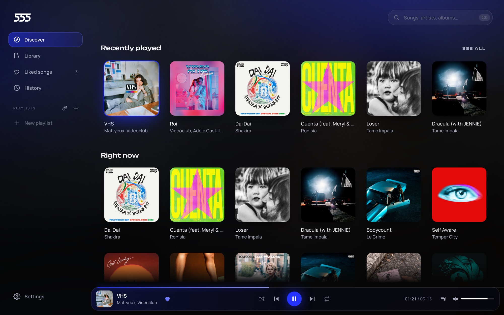
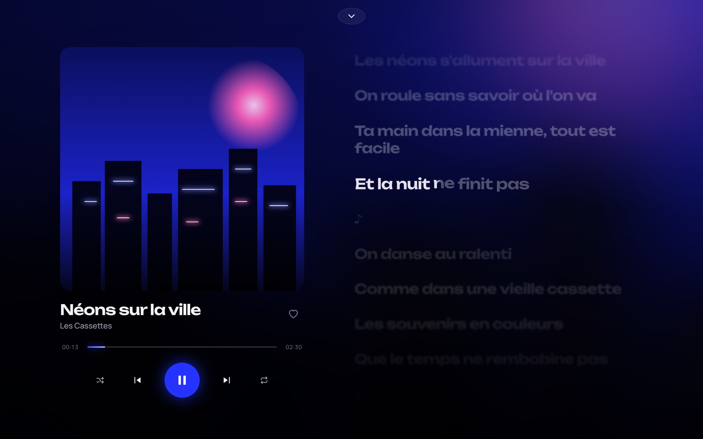
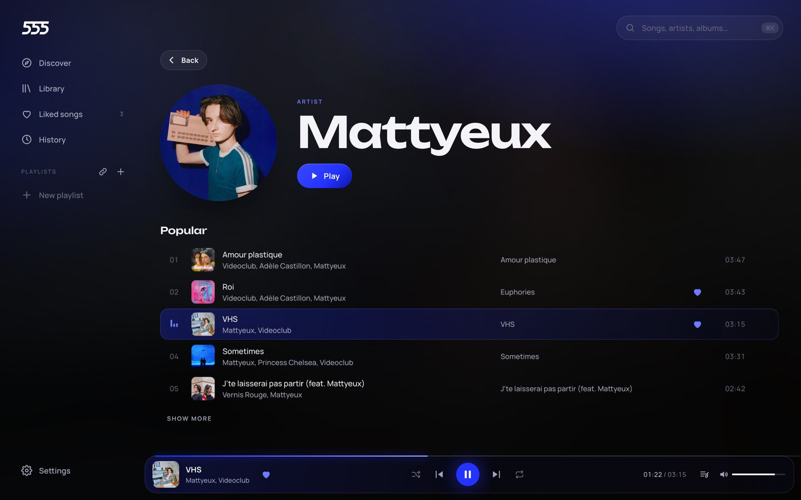

<p align="center">
  
</p>

<h1 align="center">555</h1>

<p align="center">
  A light, fast music player, written in Rust with Tauri.<br />
  <a href="https://amonre555.github.io/555/">Website</a> ·
  <a href="https://github.com/amonre555/555/releases/latest">Download</a>
</p>

<p align="center">
  
</p>

<p align="center">
  
  
</p>

## Features

- **Your local library**: MP3, FLAC, OGG, M4A/AAC, WAV, AIFF… scanned in parallel on every core, cached on disk, instant search.
- **One source for the info, one for the sound** (like Nuclear):
  - **Deezer** (public API, no key): search, charts, clean titles and albums, 1000 × 1000 covers.
  - **YouTube Music**: at play time, 555 looks for the same recording (title, artist, length, skipping live, remix, sped-up versions…) through [rustypipe](https://codeberg.org/ThetaDev/rustypipe). YouTube search is still available for versions Deezer doesn't have.
- **Instant start**: the audio stream's direct address (from rustypipe) starts the song in ~0.3 s, while [yt-dlp](https://github.com/yt-dlp/yt-dlp) starts in parallel and takes over seamlessly if YouTube cuts the direct stream. Both deliver the very same file into one buffer: the fastest one wins.
- **Progressive streaming**: playback starts while downloading, and seeking is instant.
- **Prefetching**: the next song, the first search result and hovered songs are downloaded ahead of time into memory (8 songs at most).
- **yt-dlp managed for you**: downloaded from the official releases, with yt-dlp's OpenPGP signature and the SHA-256 checksum verified, then updated every 12 h without interruption. The "folder" build is used, which starts in 0.5 s instead of 2 s.
- **Artist pages**: photo, popular songs, albums, singles and EPs, similar artists. Every artist of a song (features included) is clickable on its own.
- **Album pages**: cover, artists, year, length, track list and label. An album's name is clickable everywhere.
- **Liked songs and playlists**: a heart on every song, and playlists that mix the local library, Deezer and YouTube. Right-click or "⋯" on a song to add it, drag and drop to reorder, click the name to rename. Everything is kept in `collection.json`, in the app data.
- **Listening history**: every play (after 20 s of listening), grouped by day with the time, plus your most played songs.
- **Shuffle, repeat (queue or song) and crossfade** from 1 to 12 s (two mixed players, constant-power curves).
- **Resume**: on launch, 555 brings back the last song, the queue and the position.
- **Playlist import** from a Spotify link (no account: songs are found on Deezer), Deezer or YouTube Music.
- **English and French**, switchable in Settings → General (English by default).
- **Discord status**: "Listening to *title*", the artist, the cover and the progress bar. Very few updates (only on changes), and nothing happens when Discord is closed.
- **Word-synced lyrics**: NetEase Cloud Music (YRC format) for per-word timing, [LRCLIB](https://lrclib.net) in parallel (lines, or words in Enhanced LRC). Without word timing, it's estimated from word length, without spreading over pauses. Click a line to jump there.
- **Media keys and the system media panel** (Windows, MPRIS on Linux, macOS), with title, artist and cover.
- **Blue on black**: deep electric-blue to black gradients, a fine paper grain, wide titles (Unbounded) and clean text (Manrope), dark glass, and pages that change through a soft blur.
- **Now playing view**: the cover flies out of the player over a blue-to-black backdrop; karaoke lyrics where each word fills with white the moment it's sung.

## Install

Installers are in the [Releases](https://github.com/amonre555/555/releases): `.dmg` for macOS (Apple Silicon and Intel), `-setup.exe` for Windows. Once installed, 555 checks for a new version on launch (then every 6 h) and offers to install it in one click. Updates are signed, and the app refuses any whose signature doesn't match.

The app isn't signed by Apple or Microsoft:
- **macOS**: on first launch, right-click 555 → "Open" (or `xattr -cr /Applications/555.app`);
- **Windows**: "More info" → "Run anyway".

## Structure

```
crates/yato-core/   Rust core, independent of the UI
  src/source.rs        MusicSource trait: adding a source = implementing it
  src/sources/         Built-in sources (local, deezer, youtube)
  src/stream.rs        Progressive HTTP / process reader (several sources can fill one buffer)
  src/player.rs        Audio engine (rodio + symphonia) and queue
  src/collection.rs    Liked songs, playlists and history (collection.json)
app/                 Interface (SolidJS + Vite)
  src/i18n.ts          Translations (English, French)
app/src-tauri/       Tauri bridge: commands, events, cover:// protocol
site/                Website (GitHub Pages)
```

The core doesn't know about Tauri: it could power a mobile version (Tauri v2) or a native UI (GPUI) without a rewrite.

## Run from source

Requirements: stable Rust, Node.js 22+, MSVC build tools (Windows). Nothing else: yt-dlp installs itself on first launch (in `<app data>/bin/yt-dlp`). If that fails (offline…), 555 uses a yt-dlp already on the system (PATH or winget).

```bash
cd app
npm install
npm run tauri dev
```

Optimized build: `npm run tauri build`.

On Windows, if the project folder is very deep, the linker can hit the 260-character limit. Build elsewhere, for example `set CARGO_TARGET_DIR=C:\555-target`.

To work on the interface in a browser, without Tauri: `npm run dev` then http://localhost:1420. The core is then simulated (sample songs and lyrics), see `app/src/dev-mock.ts`. This mode is never shipped in the app. The website's screenshots come from its demo screens: `?demo` (Discover, playing), `?demo=lyrics`, `?demo=artist`, `?demo=album` and `?demo=history`, with real metadata from Deezer in `app/src/demo-data.json`.

Quick tests, without the interface:

```bash
cargo run -p yato-core --example yt -- "vhs mattyeux"
cargo run -p yato-core --example deezer -- "stromae alors on danse"   # Deezer search + YouTube audio
cargo run -p yato-core --example artist -- "sweat snoop dogg"   # full credits, artist pages, albums
cargo run -p yato-core --example match   # matches the Deezer charts and a few searches to YouTube Music
cargo run -p yato-core --example lyrics -- "tout oublier angele"   # lyrics and word timing (synced or estimated)
cargo run -p yato-core --example import -- "https://open.spotify.com/playlist/…"   # playlist import
cargo run -p yato-core --example playback   # crossfade, repeat, resume (at zero volume)
cargo test -p yato-core -- --include-ignored   # including the real signature check
```

## Publish a release

The version lives in `Cargo.toml`, `[workspace.package]`:

```bash
./scripts/release.sh 0.2.0
git push && git push origin v0.2.0
```

The "Publish a release" GitHub workflow then builds macOS and Windows, and creates the Release with `latest.json` for updates. It needs two secrets (Settings → Secrets and variables → Actions): `TAURI_SIGNING_PRIVATE_KEY` (contents of `~/.tauri/yato.key`) and `TAURI_SIGNING_PRIVATE_KEY_PASSWORD` (contents of `~/.tauri/yato.key.password`). Without this key no update can ever be published again: keep it safe.

App icons: `app/src-tauri/icons/icon.svg` is the source. `npx tauri icon` (from a 1024 px PNG of it) rebuilds every size, then `npm run icon:mac` (in `app/`) rebuilds `icon.icns` from `icon-macos.svg`, the same drawing on Apple's grid.

## Website

The website lives in `site/` (a single static page) and is published to GitHub Pages by the "Publish the website" workflow on every push to `main` that touches it. One-time setup: Settings → Pages → Source: "GitHub Actions". Download links, version and stats come from the GitHub API, so nothing needs updating on release.

## Add a source

Implement `yato_core::MusicSource` (`search`, `featured`, `resolve`) then register it in `app/src-tauri/src/lib.rs`:

```rust
sources.register(Arc::new(MySource::new(client.clone())));
```

## Add a language

Add a dictionary to `app/src/i18n.ts` (TypeScript checks that every text is translated) and an entry to `LANGUAGES`.

## License

GPL-3.0-or-later (required by rustypipe, which is GPL-3).

Playing YouTube outside its official player is against its terms of service. The YouTube source is provided as is, and everyone is responsible for their own use.
